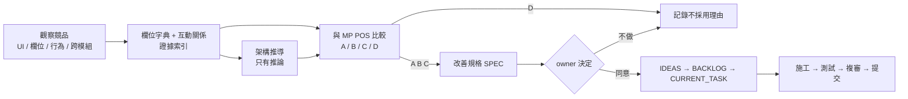

# POS Integration Blueprint

> 說明「競品蒸餾的成果」未來怎麼整合進 MP POS。跨系統共用一份，由 `/pos-distill <系統> 藍圖` 更新。
> **這份文件不是施工單**：任何改動都要 owner 決定，再照 `docs/development/README.md` 走開發流程。

| 項目 | 內容 |
|---|---|
| 依據的基準 | `_baseline/MP_POS_架構基準_2026-10-17.md`（commit `fbec2bf`） |
| 已蒸餾的系統 | lw（聯歐通訊聯盟內部管理系統，立穎所用；唯讀第一輪 2026-10-17） |
| 最後更新 | 2026-10-17（填入 lw 第一輪） |

## 1. 整合原則

1. **借規則，不借外觀**：只把競品的操作邏輯、欄位設計、商業規則、資料關係轉成 MP POS 的規格；畫面、文案、圖示、報表樣式一律照 MP POS 自己的規約。
2. **證據決定能走多遠**：只有【事實】支持的做法能分 A；只有【推論】或【待驗證】的最多 B，或先驗證再說。
3. **不可違反的決策優先**：基準檔第 8 節的 16 條，競品做法跟它衝突時，改的是做法，不是決策；要推翻決策必須 owner 明講並寫進 `docs/decisions.md`（由開發流程處理，不由本 Skill）。
4. **一個規則只有一份程式**：整合時擴充既有的唯一實作（例如 `analytics/catalog.py`、`sales/contracts.py`、`tenants/abilities.py`），不另寫平行算法。
5. **不讓既有公司突然變行為**：新增的可設定項目，預設值等於現在的行為。

## 2. 從蒸餾到上線的路徑

| 關卡 | 誰 | 過關條件 |
|---|---|---|
| 證據 | pos-distill | 規格引用的競品做法都有標記與證據；A 類都有【事實】 |
| 分類與優先 | owner | 規格狀態改成「owner 同意（等待排入開發）」 |
| 排入開發 | owner ＋ 開發流程 | 寫進 `IDEAS.md` 之後照 `docs/development/README.md` |
| 複審 | 開發流程 | 依規格寫的複審分流（開單、金額、庫存、現金、權限、資料庫一律完整審查） |

## 3. 四種整合方式

| 方式 | 對應分類 | 做法 | MP POS 已有的前例 |
|---|---|---|---|
| 規則 / 行為改善 | A、B | 改既有 app 的 service 與畫面；資料表只加欄位或加表 | 2026-10-12 起「取舊歐睿報表優點」各批（庫存三張、銷貨日報與進貨明細、報表匯出、發票明細） |
| 租戶可設定 | C | 公司層級設定放 `Tenant` 欄位或公司自訂清單表；預設值等於現在的行為；只有管理員能改 | 基準檔第 6 節（保固天數、合約提醒、業務員成本加成、付款方式、發票類型…） |
| 資料承接 | 欄位字典 | 欄位字典與名詞對照，餵給舊資料對照與匯入範本 | `backend/apps/legacy/`、`docs/imports/Excel匯入範本_v1草案_欄位.md` |
| 資料做滿、客製外放 | 介於 C 與 D | 只對部分店有意義的報表或流程：核心只補資料欄位與維度，客製部分放擴充（是否採用由 owner 決定） | `analytics/` 自由組合報表 |

## 4. 整合對照表（模組 → MP POS 落點）

競品欄位各系統填；「MP POS 落點」來自基準檔第 4 節。

| 代碼 | 模組 | MP POS 落點（app / 主要 Model） | 前端入口 | lw | <其他系統> |
|---|---|---|---|---|---|
| PRD | 商品主檔 | `catalog` / `Product`、`Category`、`PhoneModel`、`ProductRelation` | 進貨入庫 › 商品管理 | 三層 廠牌→別名→型號；型號有人工編號、條碼、補貨／清倉旗標（CMP-021 A） | |
| STK | 庫存與序號 | `inventory` / `ProductSerial`、`StockBalance`、`StockMovement`；`ledger` | 商品庫存 | 手機／配件／卡片分三套查詢；全公司合計快查；盤點四類別＋扣款審核（CMP-019 C、020 D） | |
| PUR | 進貨 | `purchasing` / `PurchaseOrder`；`vendor_orders`；`identity` | 進貨入庫 | 進貨訊息→刷序號兩段式（CMP-016 D）；原廠月補貼（CMP-017 待決） | |
| SAL | 銷貨 | `sales` / `SalesOrder`、`SalesOrderItem`、`SalesOrderPayment` | 銷貨作業 | 第二帳號：門市銷貨單多付款並列、付訂金狀態、欠客、單上毛利、九入口磚（CMP-028～034）；開單畫面無權限未見 | |
| RTN | 銷退 | `sales` / `SalesReturn` | 銷貨作業 › 銷退單 | 批發逐序號退貨、可刪除（CMP-009 B 待決、010 D） | |
| TRF | 調撥 | `transfers` / `TransferOrder` | 商品庫存 › 調撥作業 | 轉倉中／已收貨／已退貨（CMP-018 A → SPEC-003） | |
| MBR | 會員與客戶 | `parties` / `Member`、`Customer` | 客戶會員 | 會員＝門號合約一列；到期日空值篩選（CMP-035 A） | |
| TEL | 門號與佣金 | `parties` / `TelecomPlan`、`SimCard`；`sales` 明細門號欄位；`cash` / `PhoneBillCollection` | 電信作業 | 佣金表按月版本化、客戶別套餐、申辦類別 8 種、開通紀錄、退件 9 來源、29 種佣金往來項目（CMP-011～015） | |
| RPR | 維修 | `repairs` / `RepairOrder` | 維修作業 | 批發客戶維修申請、總倉送修（未看） | |
| USD | 中古機 | `inventory`、`purchasing`、`sales` | 進貨入庫 › 中古收購 | 未見 | |
| CSH | 現金與帳務 | `cash`；`sales/daily_report.py` | 門市帳務 | 每日結帳按店員、應繳 vs 實收、鎖當日；資費另結含審核（CMP-031、036） | |
| ARP | 應收應付 | 只有批發往來帳 `trade/payments.py`（逐單欠款、由舊到新沖、溢收）；門市月結、廠商應付、帳齡是缺口 | 銷貨作業 › 批發單 | 一單一應收、額度抵付、收款→銷帳、收款部門、對帳單（CMP-005～008；SPEC-001） | |
| IVC | 發票 | `tenants` / `InvoiceTrack`；`sales` | 系統設定、統計分析 › 發票明細 | 出貨單隱藏發票抬頭／統編／開票週期（未見開立） | |
| RPT | 報表 | `analytics/catalog.py` 與各 app report | 統計分析 | 查詢頁與輸出分離、報表另開視窗；報表專區對業務角色空白（CMP-027 D） | |
| ACL | 權限 | `tenants` / `UserProfile`、`abilities.py` | 平台管理、系統設定 | 業務看全公司所有倉；業務／內勤雙負責人；多處按鈕對角色停用（CMP-023 待決） | |
| CFG | 設定 | `tenants`、`inventory` / `Warehouse` | 系統設定 | 門市群組多對多（CMP-025 待決）；客戶結帳方式六種（CMP-001 C） | |
| TNT | 多公司 | `tenants`、`core`、`backup` | 平台管理 | 聯歐（平台）下多經銷商（立穎、中祥…）共用一套，門市與部門同一組織表 | |
| B2B | 批發與叫貨 | `trade`、`vendor_orders` | 銷貨作業 › 批發單、進貨入庫 › 廠商叫貨 | 訂單→出貨兩層（MP POS 已有）；客戶主檔厚：母公司、收件日、預設倉、額度、狀態五種（CMP-001～005；SPEC-002） | |

歐睿已有的舊資料（當線索）：見基準檔第 11 節。

## 5. 名詞對照（MP POS 概念 → 各系統用語）

| MP POS 概念 | 位置 | lw | <其他系統> |
|---|---|---|---|
| 公司（租戶） | `Tenant` | 經銷商（立穎、中祥…）；上層還有聯歐 | |
| 門市 | `Warehouse` | 門市／倉／分倉／部門（同一組織表） | |
| 品號（系統產生） | `Product.sku` | 型號編號（人工） | |
| 序號 / IMEI / SN | `ProductSerial`、`ProductSerialIdentifier` | 公司貨碼、商品序號、卡片序號 | |
| 來源（客戶） | `Customer` | 批發客戶／掛招店／門市（客戶類別） | |
| 會員 | `Member` | 無 | |
| 業務員 | `SalesPerson` | 業務人員 ＋ 內勤人員（IHS） | |
| 業務員佣金 / 公司佣金 | `commission` / `company_commission` | 佣金套餐（年月×電信×套餐×專案）→ 門號佣金往來帳 | |
| 業務員成本 | `staff_cost` | 未見 | |
| 作廢 | `is_void` | 取消（訂貨／出貨／進貨）；退貨有刪除 | |

## 6. 整合時必查清單（每份規格都要對過）

- [ ] 資料模型：新表繼承 `TenantOwnedModel`；舊資料用 `RunPython` 補；`apps/backup/registry.py` 已登記分類。
- [ ] 計算：單據金額走 `apps/core/money.py`（整數元），成本保留到分；單號走 `apps/core/numbering.py`；建單帶 `Idempotency-Key`；動庫存走 `apps/inventory/locking.py`。
- [ ] 報表：要不要加進 `analytics/catalog.py`；`ledger` 每日快照與對帳要不要跟著改。
- [ ] 隔離：序列化器與篩選限縮到自己公司；門市鎖定帳號的行為。
- [ ] 權限：要不要新增 `abilities.py` 項目；哪些只限管理員；成本、毛利、佣金、個資誰看得到。
- [ ] 畫面：版型照 `docs/ui-patterns.md`；入口照 `frontend/src/nav.ts`；不用彈出視窗當主作業區。
- [ ] 舊資料：`apps/legacy/` 對照與匯入範本要不要跟著改。
- [ ] 決策：跟 `docs/decisions.md` 哪幾則有關；有沒有要推翻的。
- [ ] 測試：別家公司隔離、門市鎖定、作廢照既有規則回復（分開列會回與刻意不回的）、重送只成立一次、金額四捨五入。
- [ ] 應收：批發已有往來帳（`trade/payments.py`），新的應收規格要說明跟它的關係，不另做一套平行的欠款算法。

## 7. 租戶設定候選（C 類）

| 規格（系統代號/SPEC-NNN） | 設定項目 | 放哪裡 | 預設值（= 現在的行為） | 誰能改 | 改了之後已存的單 | 狀態 |
|---|---|---|---|---|---|---|
| lw/CMP-001（規格待寫） | 同行結帳週期選項 | `TradeSetting` 或公司自訂清單表 | 「匯款／逐單」 | 管理員 | 不影響已存單 | 草稿 |
| lw/CMP-012（規格待寫） | 門號申辦類別清單 | 公司自訂清單表 | 新辦／續約／攜碼 | 管理員 | 舊單保留原值 | 草稿 |
| lw/CMP-019（規格待寫） | 盤點類別清單 | 公司自訂清單表 | 無類別（空） | 管理員 | 舊盤點單無類別 | 草稿 |
| lw/CMP-025 | 門市群組 | 新表（群組×門市多對多） | 無群組 | 管理員 | — | 待 owner 決定 |
| lw/CMP-030（規格待寫） | 付款方式的附註欄位（授權碼、期數、銀行） | `PaymentMethod` 設定「要填哪些附註」 | 不填 | 管理員 | 舊單無附註 | 草稿 |

## 8. 規格清單與狀態

| 規格（系統代號/SPEC-NNN） | 主題 | 分類 | 建議優先級 | 複審分流 | 狀態 |
|---|---|---|---|---|---|
| lw/SPEC-001 | 批發對帳單（期間彙總＋明細，沿用 `ledger()`） | A | P2 | 完整審查（顯示金額） | 草稿 |
| lw/SPEC-002 | 同行狀態加暫停往來／已停業 | A | P2 | 完整審查（守門） | 草稿 |
| lw/SPEC-003 | 調撥單退回（目的門市拒收） | A | P2 | 完整審查（開單、庫存） | 草稿 |
| lw/SPEC-004 | 商品狀態加「賣完不補」 | A | P3 | 一般 | 草稿 |

各系統的編號各自從 001 開始，這裡一律寫成 `ored/SPEC-001` 這種格式，不會撞號。

狀態只用：草稿 / 待 owner 決定 / owner 同意（等待排入開發） / 不做。「已排入開發」只由 owner 改。

## 9. 整合順序（建議，依相依性）

| 波次 | 範圍 | 理由 |
|---|---|---|
| 0（lw 第一批 A 類） | SPEC-004 → SPEC-002 → SPEC-001 → SPEC-003 | 由小到大、由不動庫存到動庫存；四件都不改既有決策，可各自獨立交付 |
| 1 | PRD、STK | 其他模組都依賴商品身份與序號；錯了全部錯 |
| 2 | PUR、SAL、RTN、TRF | 成本與庫存的進出 |
| 3 | TEL、USD、RPR、CSH、IVC | 通訊行特有的錢與單據 |
| 4 | RPT、ARP、B2B | 建立在前面的資料上；ARP 只有批發往來帳，門市月結與應付要不要做需要 owner 先決定 |
| 5 | ACL、CFG、TNT | 多公司營運前補齊 |

蒸餾完成後依實際發現調整，調整理由寫進變更紀錄。

## 10. 風險與不做

| 風險 | 怎麼避免 |
|---|---|
| 把競品的推論當事實寫進規格 | 規格引用一律帶標記；A 類只能用【事實】 |
| 照抄競品畫面或文案 | 規格只寫規則與資料關係；畫面照 MP POS 規約重新設計 |
| 一次整合太多 | 一份規格對應開發流程裡的一件事；同時只有一件在做 |
| 為單一店客製進核心 | 用 C 類設定或「資料做滿、客製外放」 |
| 競品研究越界（權限、個資、條款） | Skill 的安全限制；寫入測試要 AUTH 授權 |

## 變更紀錄
| 日期 | 做了什麼 | 相關編號 |
|---|---|---|
| 2026-10-17 | 補門市端 CMP-028～036 到對照表與租戶設定 | lw/CMP-028～036 |
| 2026-10-17 | 填入 lw：整合對照表、名詞對照、租戶設定候選 4、規格 4、波次 0 | lw/CMP-001～027、lw/SPEC-001～004 |
| 2026-10-17 | 建立骨架：整合原則、路徑、四種方式、模組落點、必查清單、整合順序 | — |
| 2026-10-17 | 依 Codex 複審修正：ARP 落點補上批發往來帳；作廢回復改成照既有規則；規格編號加系統代號 | — |
